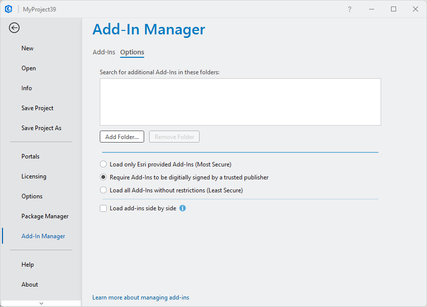

# The add-in

Notes on how it works and the things that were not obvious. For installing and
using it see [README.md](../README.md); for building it see
[BUILD.md](../BUILD.md).

---

## Why it has to run inside ArcGIS Pro

ArcGIS Pro will only let its own **Main CIM Thread** touch the open project.
`arcpy.mp.ArcGISProject("CURRENT")` from anywhere else raises `OSError:
CURRENT`, and no amount of process-level cleverness gets around it.

The first version of this project was all Python, outside Pro. To reach the
project at all it had to hand work to Pro's Python thread and wait for Pro to
service it, which happens roughly every 28 seconds while Pro sits idle. Every
call cost that.

The add-in is a .NET assembly loaded into Pro's own process, so it can use
`QueuedTask.Run` directly. Measured on the same commands: **28 s to 9 ms**.

### Three threads, and telling them apart

| Thread | What belongs on it |
|---|---|
| **MCT** (Main CIM Thread) | reading and writing maps, layers, geometry, geoprocessing |
| **UI thread** (WPF) | saving the project, opening panes, anything touching a window |
| worker threads | sockets, plain computation |

`CommandRouter.Register` puts a command on the MCT, which is right for almost
everything. `RegisterAsync` runs off it, for handlers that await Pro APIs that
do their own marshalling — awaiting inside `QueuedTask.Run` deadlocks.

Saving is the exception that had to be learned: `Project.SaveAsync`,
`SaveEditsAsync` and `DiscardEditsAsync` are **UI-thread** operations. Called
from the MCT they throw *"The calling thread cannot access this object because
a different thread owns it"* — which is WPF's wording, not CIM's, and that is
the clue. They are dispatched explicitly in `MapCommands.OnUiThread`.

---

## Layout

```text
Bridge/
  McpHttpServer.cs    MCP over HTTP on :6520/mcp, loopback only -- the only port
  CommandRouter.cs    dispatch, threading, and the Python fallback
  PythonFallback.cs   client for the optional Python bridge on :6521
  Protocol.cs         request/response shapes and parameter access
Commands/             one file per subject area
Clients/McpClients.cs registering this server with AI clients
UI/Buttons.cs         the ribbon
Config.daml           ribbon definition and version
```

One transport reaches every command:

```text
AI client ──MCP over HTTP :6520/mcp ──┐
                                      ▼
              ┌─ C# add-in (inside the ArcGIS Pro process) ──────────┐
              │   → QueuedTask.Run (Main CIM Thread)                 │
              │   execute_arcpy_code → Calculate Value → arcpy       │
              │   anything else it does not implement ─┐             │
              └────────────────────────────────────────┼─────────────┘
                                                       ▼ :6521 (optional)
                                         Python bridge, if started by hand
```

Up to 1.1.1 the add-in also listened on 6510 for a TCP bridge that the
`arcgis-pro-mcp` stdio relay and a few scripts used. No AI client the add-in
registers had used it since 1.1.1, and the ribbon's Start/Stop button switched
*that* listener rather than the MCP endpoint, so "Stop" left every AI client
connected. It is gone: the relay and the scripts now speak MCP to 6520.

HTTP exists because **stdio cannot work for an in-process server**: a stdio
client spawns a process and talks to its pipes, and this server is already
running inside Pro. HTTP inverts that — the client connects to a URL.

Both tool catalogues come from `src/arcgis_pro_mcp/catalog.py`, exported to
embedded resources by `scripts/export_tool_schemas.py`, so there is no second
place where a tool is defined.

---

## What stays in Python

Two of the 114:

| Command | Why |
|---|---|
| `get_pump_status` | it reports on the **Python** bridge's dispatcher, which only exists there |
| `stop_pump` | likewise — the add-in has no pump to stop, it uses the MCT directly |

`execute_arcpy_code` used to be the third. It now runs in the add-in through
Calculate Value (below), and goes to the Python bridge only if that fails.

A command the add-in does not know is forwarded to the Python bridge on 6521,
which reports clearly if that bridge is not running. The add-in does not
listen on 6521 itself; it only connects to it. The one port Pro has open for
this project is 6520, which goes through Windows' http.sys, so `netstat` shows
it owned by PID 4 rather than by ArcGISPro.exe.

### The Python bridge and its "pump"

The bridge is a small TCP server inside ArcGIS Pro's own Python. It receives
commands on a socket thread, but arcpy only resolves
`ArcGISProject("CURRENT")` on Pro's Python thread. The dispatcher in
`arcgis_pro_plugin/arcgis_mcp/pump.py` bridges the two: it creates a
message-only window on that thread, the socket thread queues a job and posts a
message to it, and Pro's own Windows message loop calls back to run the job.
Without it, `execute_arcpy_code` can run arcpy on datasets by path but cannot
touch the open project.

"Pump" is this project's name, borrowed from the Win32 *message pump* (the
`GetMessage`/`DispatchMessage` loop). It is not Esri terminology: the SDK
speaks of the Main CIM Thread, `QueuedTask` and the GUI thread, and has no name
for Pro's Python thread. `get_pump_status` and `stop_pump` therefore carry a
name neither users nor models can be expected to know.

Two costs come with it:

- **It has to be started by hand**, from Pro's Python window, every session:
  `import mcp_bridge; mcp_bridge.start_server(port=6521); mcp_bridge.start_pump()`.
  The auto-start hook (`arcgis_mcp_autostart.py`) starts the server only, not
  the pump, and installing it needs write access to Pro's `site-packages`
  under Program Files. Starting the bridge from `ArcGISMCP.pyt` through
  `run_python_toolbox_tool` stops on Pro's "Allow this toolbox code to run?"
  security prompt. Its autostart config used to default to port 6510, which
  the add-in holds; it now defaults to 6521.
- **It is slow.** Pro services that thread on its own schedule: seconds while
  in use, up to about 28 s per command while idle (commit 8b41d01) -- the
  reason the add-in exists.

In practice the third layer is simply absent for anyone who installed only the
`.esriAddinX`. In the benchmark pilot of 2026-10-16, 11 of 20 agent episodes
tried `execute_arcpy_code`, got the "not listening on 127.0.0.1:6511" error (the port used up to 1.1.1),
and fell back to the named tools; 19 of 20 still succeeded.

### Calculate Value runs Python in process, without the pump

Calculate Value here is the **ModelBuilder** tool of that name
(`management.CalculateValue`), which returns one value from a Python or Arcade
expression to feed other tools in a model. It is not Raster Calculator or any
raster tool; the add-in uses it only as a way to run a Python code block inside
Pro.

Found 2026-10-17 on ArcGIS Pro 3.7.1.1904. `management.CalculateValue`, run
through the add-in's own geoprocessing path (`run_geoprocessing_tool`, so
`Geoprocessing.ExecuteToolAsync` on the MCT), executes a Python expression and
code block inside Pro, and that code **can** resolve the open project:

```python
# args, positionally: expression, code block, data type
["probe()",
 "import arcpy\n"
 "def probe():\n"
 "    aprx = arcpy.mp.ArcGISProject('CURRENT')\n"
 "    return aprx.filePath + ' | ' + ', '.join(l.name for l in aprx.listMaps()[0].listLayers())\n",
 "String"]
```

It returned the open project's path and its three layers. Timings, three
calls in a row with the bridge and pump **not** running:

| Call | Time | Note |
|---|---|---|
| 1 | 17.35 s | Pro initialising its Python on first use |
| 2 | 0.06 s | |
| 3 | 0.05 s | |

No security prompt: it is a system tool, not a third-party toolbox. The tool is
not in `gp-parameters.json`, so named parameters are refused and the values
have to be passed positionally (`args`).

Before building on it:

- **It is outside Esri's documented use.** The tool reference says Calculate
  Value "is only available from ModelBuilder", not from the Geoprocessing pane
  or Python. It works through the SDK today; a later release could stop it
  without notice. Keep the pump as the fallback and check the path at start-up.
- **Tested next, all on 3.7.1, all passing:**

  | Check | Result | Time |
  |---|---|---|
  | Change the open map through `arcpy.mp` (add a layer, rename it, hide another) | the add-in's `get_layers` saw all three changes at once | 1.47 s |
  | Capture `print()` output | `contextlib.redirect_stdout` returns it | 0.03 s |
  | Keep variables between calls | a module in `sys.modules` survives; a counter went 1 → 2 and a later call read it | 0.04 s |
  | An exception in the code | comes back as a full traceback | 0.03 s |

- **Only tested on 3.7.1.** The add-in builds against 3.7 and will not load on
  anything older, so 3.3 and 3.4 do not arise today; any newer Pro has to be
  checked again before relying on this path.

`execute_arcpy_code` is now `Commands/PythonCommands.cs`. It writes the code to
a temporary file under `%LOCALAPPDATA%\ArcGIS-MCP\code`, runs Calculate Value
with a fixed runner as the code block, and returns what the Python bridge's
handler used to: `output`, `value`, `variables` and `elapsed_seconds`, with the
namespace kept in `sys.modules["_arcgis_mcp_session"]`. If Calculate Value
itself fails to run, the call is logged and forwarded to the Python bridge.

If those hold, `execute_arcpy_code` could run through Calculate Value inside
the add-in. The third layer would then be on for every user, as fast as the
other two, with no bridge, no pump, no port and no prompt -- and the pump tools
could be hidden or renamed.

---

## Geoprocessing by name

The Pro SDK runs geoprocessing tools **positionally** and exposes no API for a
tool's parameter names. Hand-built positional arrays were tried first and put
`select_by_location`'s `invert` flag into the output-layer slot — the kind of
mistake that produces a plausible wrong answer rather than an error.

So the parameter order for roughly 2,000 tools is dumped from arcpy by
`scripts/dump_gp_parameters.py` and embedded as `gp-parameters.json`. Every
command that runs a tool passes named values, and `RunNamedAsync` places them.

This table has to be regenerated for each ArcGIS Pro version — see
[BUILD.md](../BUILD.md#upgrading-arcgis-pro).

### `add_to_map` and the flags

`GPExecuteToolFlags.Default` **already includes** `AddOutputsToMap` — Esri's
own documentation for it reads "adds outputs to map and refreshes project
items". Code of the shape

```csharp
var flags = GPExecuteToolFlags.Default;
if (addToMap) flags |= GPExecuteToolFlags.AddOutputsToMap;   // wrong
```

means `add_to_map: false` adds the layer anyway. Every intermediate result any
workflow produced ended up in the table of contents because of it. The flags
are now chosen, not added to.

---

## AI clients

Every path and format below was read off a real installation. This matters more
than it sounds: a config written in the wrong shape does not fail, it is
**ignored**, and the user is left with a client that reports no problem and
still cannot see ArcGIS Pro.

| Client | File | Shape | Transport |
|---|---|---|---|
| Claude Code | `~/.claude.json` | `mcpServers` | HTTP |
| Codex | `~/.codex/config.toml` | `[mcp_servers.arcgis]` | stdio |
| Antigravity | `~/.gemini/antigravity/mcp_config.json` | `mcpServers` + `serverUrl` | HTTP |
| VS Code | `%APPDATA%/Code/User/mcp.json` | `servers` | HTTP |
| Cursor | `~/.cursor/mcp.json` | `mcpServers` | HTTP |
| Cline | `~/.cline/data/settings/cline_mcp_settings.json` | `mcpServers` | HTTP |
| Gemini CLI | `~/.gemini/settings.json` | `mcpServers` | HTTP |
| Claude Desktop | `%APPDATA%/Claude/claude_desktop_config.json` | `mcpServers` | stdio |

Antigravity infers the transport from `serverUrl` and rejects an unexpected
`type`. Codex and Claude Desktop launch a server rather than connecting to one,
so they get the stdio relay; if `arcgis-pro-mcp.exe` is not installed the
button says so instead of writing a config that points at nothing.

Configs are backed up as `<file>.arcgis-mcp.bak` before being touched. Rewriting
JSON reflows the whole file and drops comments — one of these files is 55 KB of
a user's unrelated settings. Codex's TOML is edited as text instead, appending
one table, so nothing else in the file moves.

`tests/client-registration` covers the round trip against copies: that
registering and unregistering leaves everything else byte for byte, including
Codex's other `[mcp_servers.*]` tables.

---

## Signing the add-in

ArcGIS Pro decides what to load from
`HKCU\SOFTWARE\ESRI\ArcGISPro\Settings\BlockAddIns`:

| Value | Meaning |
|---|---|
| `0` | load everything — what an unsigned add-in needs |
| `1` | only add-ins signed by a trusted publisher |
| `2` | only Esri's |

The per-user value wins over the machine-wide one. Pro's installer writes `0`
to HKLM, so **on a machine nobody has configured, an unsigned add-in loads**.

The same three choices appear in ArcGIS Pro under **Project ▸ Add-In Manager ▸
Options**, which is where to look when the MCP tab does not appear:



An `.esriAddinX` is a zip and cannot carry an Authenticode signature the way an
`.exe` does. Pro signs it as an OPC package, and ships the tool that does it:
`ArcGISSignAddIn.exe` in Pro's `bin`. Run with no arguments it opens a wizard;
it also takes `/cert-thumbprint:`, `/c:`, `/p:`, `/n:` and `/s`, which is what
`scripts/sign_addin.ps1` uses.

### What Pro actually enforces

Tested one property at a time against Pro 3.7.1 at `BlockAddIns = 1`, by
signing the add-in and restarting Pro to see whether it loaded:

| Checked? | Detail |
|---|---|
| ❌ **EKU** | a Server Authentication (TLS) certificate signed it and Pro loaded it |
| ❌ **Trusted Publisher** | removed from that store, left only in Root, still loaded |
| ✅ **chains to a trusted root** | a certificate in no store at all is blocked |
| ✅ **not expired** | a certificate a year past its `NotAfter` is blocked |

So the question Pro asks is *"did someone this machine trusts sign it, and is
their certificate still valid"* — weaker than the Authenticode check Windows
applies to an `.exe`, which does enforce the Code Signing EKU.

### No timestamp

The signature carries only a `SignatureTime` the signer writes itself, covered
by its own signature and proving nothing to anyone else. There is no RFC 3161
countersignature.

With the expiry check above, that means **the signature dies with the
certificate**: on the day it expires, every distributed copy stops loading at
once, and re-signing is not enough — the file has to go out again.
`sign_addin.ps1` therefore issues twenty-year certificates by default. There is
nothing to gain from a short life on a certificate you issue to yourself.

### Distributing to other people

A self-signed certificate is trusted on the machine that created it and nowhere
else. For anyone else, the options are:

1. `BlockAddIns = 0` on their machine — simplest, and what most machines
   already have
2. their own certificate, made and trusted with `sign_addin.ps1` on their
   machine
3. a certificate from a public CA, which every machine already trusts

Do not hand someone a self-signed `.pfx` to install as a trusted root. That
asks them to trust everything signed with that key, which is worse than
`BlockAddIns = 0`.

---

## Things that fail silently

Collected because each cost an afternoon:

- **A DAML control id containing a hyphen is dropped.** Three ribbon buttons
  simply were not there, with no error anywhere. Ids use underscores.
- **Small buttons in a ribbon group render as bare icons**, captions and all
  discarded — no use when the caption is the client's name.
- **`%USERPROFILE%\Documents` is not Documents** when OneDrive folder backup is
  on. Use `GetFolderPath(MyDocuments)`, or the add-in lands where Pro will
  never look.
- **Two `.esriAddinX` files with the same add-in id**: Pro loads one of them and
  every change made to the other appears to do nothing. The installer removes
  older copies before installing.
- **`MSB4025`**: an MSBuild XML comment cannot contain `--`.
- **`CodeTaskFactory`**, used by Esri's own packaging targets, is unsupported by
  the .NET Core MSBuild behind `dotnet build`. The package layout is simple
  enough to reproduce directly: `Config.daml` at the root, assemblies under
  `Install\`.
- **`count_features` counted the source table**, ignoring the layer's
  definition query, and `order_by` did nothing at all on shapefiles. Both
  reported success with the wrong answer.

---

## Using it

- Layers inside a group need their full name, `"Group\Layer"`, for anything
  that runs through geoprocessing — otherwise
  `ERROR 000732: Dataset does not exist`.
- `duplicate_layer` copies the **layer**, not the data. Both layers point at
  the same dataset, so `add_fields` on the copy edits the original.
- ArcGIS Pro holds edits open so they can be undone, which also keeps the data
  locked. `save_edits` commits them.
- An in-memory dataset does not survive a Pro restart. `get_broken_layers`
  finds what is left pointing at nothing.
